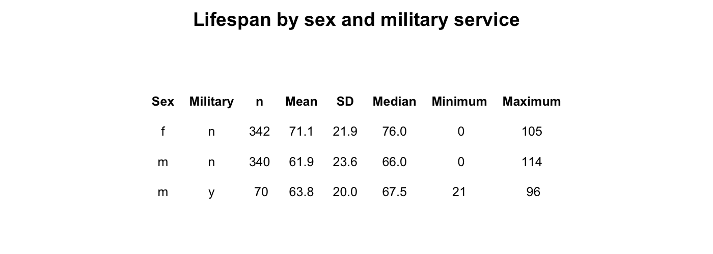
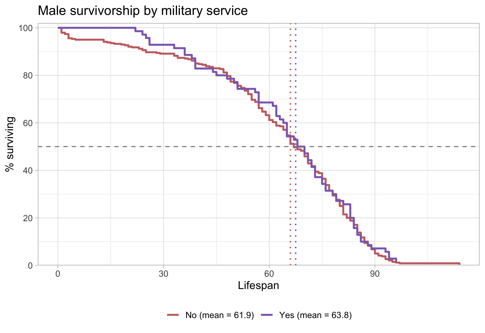

```{=latex}
\onecolumn
\begingroup
\thispagestyle{empty}
\sffamily

% Publication line and journal masthead
\noindent
\begin{minipage}[t]{0.66\linewidth}
  \scriptsize
  Lopez. \textit{Survivorship Curves of Sunset Hill Cemetery}
  \hfill (2026) 1:1\\
  Valdosta State University, Ecology and Evolution
\end{minipage}
\hfill
\begin{minipage}[t]{0.30\linewidth}
  \raggedleft
  \large Cemetery Demography\\[-2pt]
  \large BIOL 3250
\end{minipage}

\vspace{0.28in}

% Article-type band
\noindent
\colorbox{reportred}{%
  \parbox{\dimexpr\linewidth-2\fboxsep\relax}{%
    \color{white}
    \textbf{RESEARCH ARTICLE}\hfill
    \textbf{CLASS PROJECT}
  }%
}

\vspace{0.18in}

% Title and author line
\noindent
{\fontsize{23}{27}\selectfont
\textbf{Lifespan is Effected by Military Status}\par}

\vspace{0.12in}

\noindent
{\small
Matthew Lopez\textsuperscript{1,*}
}

\vspace{0.08in}

% Structured abstract
\setlength{\fboxsep}{6pt}
\noindent
\fcolorbox{reportred}{white}{%
  \begin{minipage}{\dimexpr\linewidth-2\fboxsep-2\fboxrule\relax}
    \small

    \textbf{Abstract}

    \vspace{3pt}

    \textbf{Purpose:}
    This project describes lifespan patterns in cemetery records and examines
    variation by sex and military service of males.

    \vspace{3pt}

    \textbf{Methods:}
    The data was collected at sunset hill cemetery in valdosta, georgia on October 8th, 2026. Went during a sunny warm day at 2:30pm. The data was sampleed from the middle of the cemetery. Recorded available birth and death information from gravestones
    and classified selected characteristics using evidence visible on the
    stones and in burial arrangements. The data was also spread between seperate families to prevent over-representing one family.

    \vspace{3pt}

    \textbf{Results:}
    The principal patterns in the class data demonstrated a correlation in shorter life span of people that served in the military compared to those that did not. [Summarize the principal patterns in the class data.]

    \vspace{3pt}

    \textbf{Conclusions:}
    The observed patterns suggest that people that served in the military lived shorter lifes than those that did not serve in the military. 

    \vspace{3pt}

    \textbf{Keywords:}
    cemetery records; lifespan; survivorship; historical demography
  \end{minipage}%
}

% Bottom-page author and institutional details
\vfill

\noindent\rule{0.56\linewidth}{0.4pt}

\vspace{3pt}

\noindent
{\scriptsize
\textsuperscript{*}Correspondence: bLopez@valdosta.edu\\
\textsuperscript{1}Department of Biology, Valdosta State University,
Valdosta, Georgia, USA\\
Ecology and Evolution, BIOL 3250, Section B
}

\vspace{0.10in}

\noindent
\begin{minipage}[c]{0.20\linewidth}
  \includegraphics[width=0.72in]{Valdosta_State_University_seal.png}
\end{minipage}
\endgroup
\twocolumn
```

# Background

Cemetery records provide individual birth and death dates that can be used to describe lifespan among people represented in a burial ground. These records are a non-random sample: cemetery access, preservation of markers, migration, family burial practices, and the choice of graves to record may all affect which people appear in the dataset. The analyses below therefore describe the collected sample and should not be treated as direct estimates of lifespan for an entire town or historical population.

# Hypotheses

3. **Military service and lifespan:** I hypothesize that male records marked as military service will show lower lifespan than records not marked for service because [brief rationale].


# Methods

Complete the prompts below. Replace bracketed text with details from the field visit and the final class dataset.

## Field site and sampling

- **Where did you go?** Sunset hill cemetery, Valdosta, Georgia
- **What date and time of day did you collect records?** 10/08/26, 2:15/4:15,
- **What part of the cemetery did you sample?** The middle of the cemetery
- **How did you choose graves?** The sampling was at random and graves that showed military service were prefered.
- **How did you handle nearby graves and family plots?** We distanced the graves we chose to avoid over repersenting one singlular family. 

## Recorded information and variable definitions

- **What information did you record from each marker?** Name, date of birth, year of death, gender, and military indicators.
- **How was lifespan calculated?** Age was transcribed from the marker and calculated as death year minus birth year
- **How did you determine marital status?** Marital status was determined by markings on the gravestones that said married.
- **How did you determine military service?** service branch, rank, unit, or veteran symbols.
- **How did you determine sex or gender?** The Gender was infered.
- **How were missing, illegible, or ambiguous records handled?** We skipped over these since there was plenty of gravestones.

## Dataset and analysis

- **How many records were collected by you?** n = 50
- **How many records were included in the final analysis?** n = 50
- **Were records aggregated with the class dataset?**  yes they were all put together in one big data collection.
- **What summaries or plots were produced?**   By looking at empirical survivorship curves, we summarized that the dip in the life span of males was correlated to military service. 
- **What are the limits of the sample?** Most of the people that died in WW II had a mass burial. This means that the veterns in sunset hill probably died due to different reasons other than the war.

# Results

{#fig-summary width=90% fig-pos="t" fig-env="figure*"}

The sex-specific survivorship curves in @fig-military show a different pattern: the plotted means are 61.1 years for males and 57.3 years for females. The male curve remains higher through much of the earlier and middle lifespan, while the female curve reaches the 50% survival point later. The curves are close and change relative position, so the figure suggests that the sex difference depends on which part of the lifespan distribution is considered. The median markers indicate where each group’s observed curve reaches 50% surviving; they are distinct from the mean values shown in the legend.

{#fig-military width=70% fig-pos="t" fig-env="figure*"}


# Discussion

The hypothesis is not suppoted, potentially as an artifact of data collection not including arlington cemetery where most military males that fought and died in the line of service were buried. 

**Historical changes in lifespan and childhood survival.** Life expectancy at birth is strongly affected by deaths in infancy and childhood, so a low historical average does not mean that every adult died young. Improvements in clean water and sanitation contributed substantially to mortality declines in the United States during the twentieth century, especially for infants and children [@cutlerRolePublicHealth2005]. The birth-period pattern in this sample [describe results] may be consistent with changing survival conditions, but birth year alone cannot identify which changes mattered. Vaccination, nutrition, medical care, living conditions, and the incomplete representation of people in cemetery records may also contribute to differences across cohorts.


```{=latex}
\newpage
```

### References

::: {#refs} 
::: 
